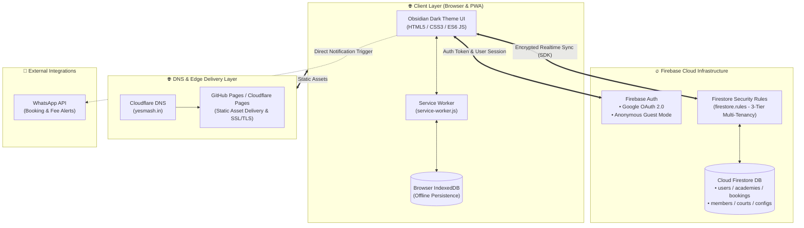
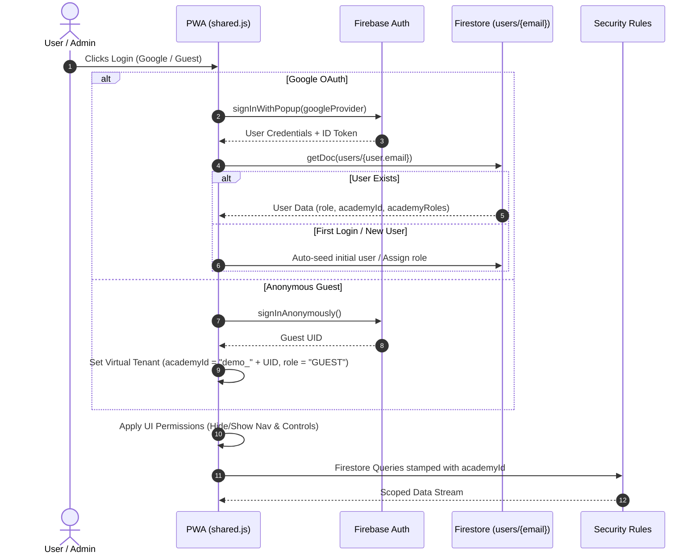
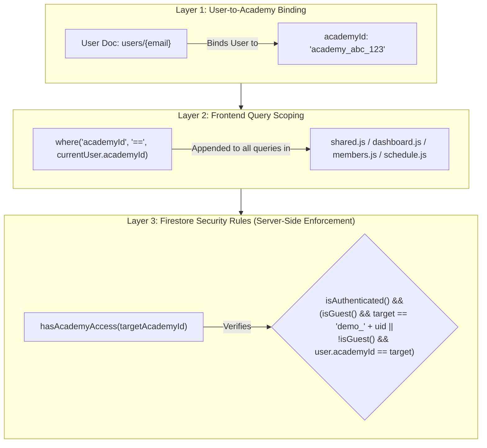

# System Architecture & Component Diagram

This document provides a comprehensive technical architecture specification and structural diagrams for **Smash.** (a multi-tenant, serverless Progressive Web Application for badminton court booking, member management, and operational analytics).

---

## 1. 🏗️ High-Level System Architecture

The application is built on a **Serverless JAMstack & Edge Architecture**, combining a client-side Progressive Web App (PWA) with Cloudflare DNS, GitHub Pages / Cloudflare Pages static hosting, and Google Firebase backend services.



---

## 2. 🔐 Authentication & RBAC Control Flow

The authentication system supports both **Google OAuth 2.0** and **Anonymous Guest Mode**, mapped to a granular Role-Based Access Control (RBAC) hierarchy stored in Firestore.



### Roles & Permissions Matrix

| Role | Access Scope | Manage Users | Programs & Tariffs | Book Courts | View Financials |
| :--- | :--- | :--- | :--- | :--- | :--- |
| **`SUPER_ADMIN`** | System-Wide (All Academies) | ✅ Full | ✅ Full | ✅ Full | ✅ Full |
| **`TENANT_ADMIN`** | Own Academy (`academyId`) | ✅ Staff Users | ✅ Full | ✅ Full | ✅ Full |
| **`STAFF`** | Own Academy (`academyId`) | ❌ Blocked | ⚠️ Flag Dependent (`allow_staff_program_edit`) | ✅ Full | ❌ Blocked |
| **`GUEST`** | Isolated Demo Tenant (`demo_{uid}`) | ❌ Blocked | ❌ Read-Only | ✅ Demo Only | ⚠️ Demo Only |

---

## 3. 🏢 Multi-Tenancy Data Isolation Architecture

Data isolation between academies (tenants) is guaranteed through a **3-Layer Security Model**:



---

## 4. 🔄 End-to-End Data Flow (Programs ➔ Reserve Court ➔ Members UI)

The diagram below illustrates how configuration changes made in the **Programs** module dynamically flow into the **Reserve a Court** dashboard form, execute batch transactions, and auto-enroll trainees in the **Members Directory**.

```mermaid
flowchart LR
    subgraph Programs ["1. Tariff & Program Config"]
        P1["programs.html / programs.js"] -->|"Autosaves Config"| DB_Acad[("academies/{academyId}<br/>(tenantSettings)")]
    end

    subgraph Dashboard ["2. Court Allocation & Reserve Form"]
        DB_Acad -->|"loadTenantSettings()"| SJS["shared.js<br/>(in-memory tenantSettings)"]
        SJS -->|"getBookingHierarchy()"| H["Dynamic Hierarchy<br/>(Type ➔ Category ➔ Period)"]
        H -->|"populateBookingDropdowns()"| Form["Reserve a Court Form<br/>(dashboard.html)"]
        Form -->|"Submit handleBookingSubmit()"| Batch["Batch Write Document"]
    end

    subgraph DB ["3. Database Operations"]
        Batch -->|"Write Allocations"| DB_Book[("bookings collection")]
        Batch -->|"Auto-Enroll Member"| DB_Mem[("members collection")]
    end

    subgraph MembersUI ["4. Members Directory"]
        DB_Mem -->|"loadMembers()"| MJS["members.js"]
        DB_Acad -->|"getPlanDetails()"| MJS
        MJS -->|"Render Table + Payment Alerts"| MTable["Members Directory Page"]
    end
```



---

## 5. 📲 PWA & Offline Synchronization Engine

```mermaid
flowchart TD
    subgraph Browser ["Client Web Browser"]
        DOM["UI Components & Pages"]
        SW["Service Worker (service-worker.js)<br/>• Version: smash-cache-v1<br/>• Strategy: Stale-While-Revalidate"]
        Cache["Cache Storage<br/>(HTML, CSS, JS, Assets)"]
        IDB[("IndexedDB Persistence<br/>(Firestore Offline Cache)")]
    end

    subgraph Network ["Cloud Infrastructure"]
        GH["GitHub / Cloudflare Pages"]
        FS["Cloud Firestore Database"]
    end

    DOM <-->|"Serve UI Assets"| SW
    SW <-->|"Cache Match / Put"| Cache
    SW <-->|"Network Fetch"| GH
    DOM <-->|"Offline Read / Write"| IDB
    IDB <==="Auto-Sync on Reconnect"===> FS
```

---

## 6. 🧩 Detailed File & Component Registry

| Component | Target File | Responsibilities | Key Implemented Functions |
| :--- | :--- | :--- | :--- |
| **Global Initializer & Auth** | [js/shared.js](file:///c:/Users/Admin/Documents/POC/Badminton/js/shared.js) | Firebase initialization, Auth state listener, User RBAC lookup, dynamic dropdown builder, toast notifications, email masking. | `checkUserAccess()`, `loadTenantSettings()`, `getBookingHierarchy()`, `maskEmail()` |
| **Operations Dashboard** | [js/dashboard.js](file:///c:/Users/Admin/Documents/POC/Badminton/js/dashboard.js) | Booking allocations modal, revenue projection calculator, stats cards, auto-enrollment into members directory. | `handleBookingSubmit()`, `loadDashboardStats()`, `calculateMonthlyRevenue()` |
| **Daily Matrix Timeline** | [js/schedule.js](file:///c:/Users/Admin/Documents/POC/Badminton/js/schedule.js) | Interactive daily grid timeline (06:00 to 22:00), sticky hour markers for mobile, court allocation slots. | `renderMatrix()`, `loadScheduleData()`, `handleCellClick()` |
| **Member & Fee Management** | [js/members.js](file:///c:/Users/Admin/Documents/POC/Badminton/js/members.js) | Trainee directory, payment status calculations (Paid/Due/Overdue), payment recording, WhatsApp reminders. | `loadMembers()`, `getPlanDetails()`, `renderMembersTable()`, `markAsPaid()` |
| **Programs & Rates** | [js/programs.js](file:///c:/Users/Admin/Documents/POC/Badminton/js/programs.js) | Management of 19 tariffs (Memberships, Hourly, Coaching, PT), secure auto-save with permission guards. | `handleSave()`, `renderMemberships()`, `renderCoaching()`, `triggerAutoSave()` |
| **Coaching & Attendance** | [js/coach.js](file:///c:/Users/Admin/Documents/POC/Badminton/js/coach.js) | Coaching batch overview, daily trainee attendance tracking, session notes logging. | `loadCoachingBatches()`, `recordAttendance()` |
| **System Settings** | [js/settings.js](file:///c:/Users/Admin/Documents/POC/Badminton/js/settings.js) | Super Admin academy management panel, Tenant Admin staff management panel, Guest mode gating. | `loadAcademies()`, `loadStaffUsers()`, `saveStaffUser()` |
| **Database Security Rules** | [firestore.rules](file:///c:/Users/Admin/Documents/POC/Badminton/firestore.rules) | Production security rules enforcing 3-tier multi-tenant isolation, role permissions, and guest sandbox access. | `hasAcademyAccess()`, `isSuperAdmin()`, `isTenantAdmin()` |
| **Offline Service Worker** | [service-worker.js](file:///c:/Users/Admin/Documents/POC/Badminton/service-worker.js) | Service worker implementation with Stale-While-Revalidate caching strategy and background update notifications. | Install, Activate, Fetch events, `skipWaiting` |
| **Web App Manifest** | [manifest.json](file:///c:/Users/Admin/Documents/POC/Badminton/manifest.json) | PWA configuration metadata defining icons, colors (`#0f172a`), standalone display mode, and app title. | Application Metadata |
| **DNS Configuration** | [CNAME](file:///c:/Users/Admin/Documents/POC/Badminton/CNAME) | Custom domain routing targeting `yesmash.in` via Cloudflare DNS. | Domain Routing |

---

## 7. 🔒 Database Schema Reference

```
cloud.firestore/
├── users/ {email}
│   ├── email: string
│   ├── role: "SUPER_ADMIN" | "TENANT_ADMIN" | "STAFF"
│   ├── academyId: string
│   └── academyRoles: map [academyId: role]
│
├── academies/ {academyId}
│   ├── name: string
│   ├── created_at: timestamp
│   ├── allow_staff_program_edit: boolean
│   └── tenantSettings: object (membership_programs, hourly_slots, coaching_schedule, fee_structure)
│
├── bookings/ {bookingId}
│   ├── academyId: string
│   ├── court_id: string
│   ├── date: string (YYYY-MM-DD)
│   ├── start_time: string (HH:MM)
│   ├── end_time: string (HH:MM)
│   ├── booking_type: string
│   ├── customer_name: string
│   ├── customer_email: string (masked in UI)
│   ├── userId: string
│   └── enrollees: array of strings
│
├── members/ {memberId}
│   ├── academyId: string
│   ├── name: string
│   ├── type: string (planKey)
│   ├── joinDate: string
│   ├── lastPaidDate: string
│   ├── bookingId: string
│   └── status: "active" | "inactive"
│
├── courts/ {courtId}
│   ├── academyId: string
│   └── name: string ("Court 1", "Court 2", ...)
│
└── configs/ {configId}
    ├── academyId: string
    └── rates / auth settings
```
