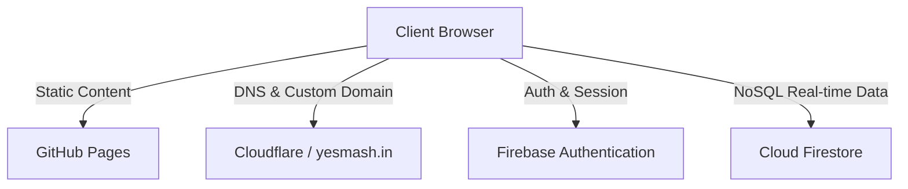

# Migration to GitHub Pages & Firebase with FinResolver UI Design

This plan outlines the migration of the Badminton Court Booking application from a FastAPI/SQLite backend model to a serverless architecture. The frontend will be hosted on **GitHub Pages** (using the domain `yesmash.in`), and the database/user management will be powered by **Firebase** (Firestore + Auth). The UI will be completely redesigned to match the premium, high-contrast dark aesthetic of `finresolver.com`.

## Architecture Overview

- **Frontend Hosting:** GitHub Pages serves the static HTML/CSS/JS. DNS management through Cloudflare will map `yesmash.in` to the GitHub Pages repository.
- **Database:** Firebase Firestore stores collections for `courts` and `bookings`. All database actions (queries, creation, updates, deletions) occur client-side using the Firebase Web SDK.
- **Authentication:** Firebase Authentication handles user identities via Google Sign-In and Anonymous Guest access. This enables secure edit/delete permissions (so users can only manage bookings they created).
- **Security & Validation:** Real-time overlap verification is performed in JS before write operations. Standard Firestore Security Rules protect records from unauthorized modifications.

---

## User Review Required

> [!IMPORTANT]
> **Firebase Project Setup Required:**
> To enable database and authentication services, you will need to create a free Firebase project. I will provide step-by-step instructions on:
> 1. Creating a Firestore Database.
> 2. Enabling Firebase Auth (Google Provider & Anonymous Sign-in).
> 3. Generating a web configuration config file (`config.js`) for your keys.
> 
> **Are you comfortable setting up a Firebase account, or would you like me to detail that process first?**

> [!WARNING]
> **Custom Domain Setup (`yesmash.in`):**
> Since you have already moved your nameservers to Cloudflare, pointing `yesmash.in` to GitHub Pages is highly recommended. It requires setting up CNAME/A records in Cloudflare and enabling HTTPS on GitHub Pages settings. This is a manual configuration step on your side.

---

## Open Questions

- **Booking Guidelines/Rules:** Should there be any restrictions on booking hours or durations? Currently, it allows arbitrary hour ranges (e.g. 06:00 to 22:00) in increments of hours.
- **Admin Accounts:** Do we need a separate "Admin" login that can delete or edit *anyone's* booking, or is ownership verification (only creator can modify) sufficient for your needs?

---

## Proposed Changes

We will restructure the project to deprecate the Python backend entirely, shifting all code to a clean, modular frontend folder.

### [Frontend - Main Application]

#### [NEW] [config.example.js](file:///c:/Users/Admin/Documents/POC/Badminton/frontend/config.example.js)
- A template file showing how the Firebase credentials configuration should be structured. The user will copy this to `config.js` and paste their Firebase project config dictionary.

#### [MODIFY] [index.html](file:///c:/Users/Admin/Documents/POC/Badminton/frontend/index.html)
- Completely rewrite the entry page into a Single Page Application (SPA).
- **Screens to implement:**
  1. **Login Portal Screen:** Sleek left-hand branding panel with logo, badminton illustrations/features, Google Sign-In button, and "Guest Mode" button.
  2. **Dashboard/Home Screen:** Shows monthly stats (active bookings, court list, current day's bookings summary) and the Interactive Calendar.
  3. **Daily Schedule Matrix Screen:** Color-coded timeline grid of hourly court slots (6:00 to 22:00) replacing `daily.html`. Clicking open slot allows quick booking; clicking booked slot opens Details & Enrollees management.
- **Common Components:** Top header bar with hamburger menu, logo, Google profile avatar, user name, and theme toggle (Sun/Moon).

#### [MODIFY] [style.css](file:///c:/Users/Admin/Documents/POC/Badminton/frontend/style.css)
- Implement a complete styling overhaul using design tokens from `finresolver.com`:
  - **Colors:** Deep Slate (`#0d1117`), Dark Surface (`#151c28`), Border (`#263040`), Mint Green Accent (`#00e5a0` representing tennis/badminton lines), Coral Red (`#ff6b6b`), Gold Yellow (`#ffd166`), Sky Blue (`#4dabf7`).
  - **Fonts:** Import Google Fonts: `'Syne', sans-serif` for titles/logos, `'Inter', sans-serif` for standard UI elements, and `'DM Mono', monospace` for times/dates.
  - **Effects:** Soft glassmorphism, dynamic glowing gradient backgrounds, active border transitions, hover lifts, and clean modal fade-in animations.
  - **Responsive Layout:** Grid adjustments for mobile compatibility, collapsible sidebar navigation drawer, and side-scrollable daily matrix table.

#### [MODIFY] [app.js](file:///c:/Users/Admin/Documents/POC/Badminton/frontend/app.js)
- Replace REST API requests with Firebase Web SDK (v10+) modular function calls.
- **Core Operations:**
  1. **Authentication Handling:** Monitor user state change (`onAuthStateChanged`). Inject Google Auth user credentials (email, name, avatar) or Anonymous credentials into forms.
  2. **Firestore Seeding:** Auto-seed the `courts` collection on first startup with Court 1, Court 2, Court 3 if they don't exist.
  3. **Overlap Conflict Checking:** Query bookings matching specified `court_id` and `date`. In JS, check if `startTime < existingEndTime && endTime > existingStartTime`.
  4. **Single Booking:** Write new booking details to `bookings` document, attaching `userId`.
  5. **Bulk Month Booking:** Fetch all bookings for selected month. Check conflicts for all applicable days in-memory, then write all validated slots to Firestore using `writeBatch`.
  6. **Enrollment/Add Member:** Add/append user names to booking enrollees array in Firestore.
  7. **Edit / Delete Operations:** Verify user matches creator `userId` (or is signed in via Google) before updating details or deleting bookings.

#### [DELETE] [daily.html](file:///c:/Users/Admin/Documents/POC/Badminton/frontend/daily.html)
- Deprecated. All daily schedules are handled dynamically within the main SPA (`index.html`).

#### [DELETE] [daily.js](file:///c:/Users/Admin/Documents/POC/Badminton/frontend/daily.js)
- Deprecated. Logic moved into unified `app.js` routing mechanism.

### [Backend - Deprecated]

#### [DELETE] [backend/](file:///c:/Users/Admin/Documents/POC/Badminton/backend)
- The entire backend subdirectory containing Python APIs, SQL databases, and dependencies is deprecated.

---

## Verification Plan

### Automated Tests
We will build a local serverless tester or utilize Jest to verify:
- Booking conflict algorithms (detect overlapping hour blocks correctly).
- Date calculation routines (calculate month days, skipping weekends if `weekdays` mode is selected).

### Manual Verification
1. **Local Live Testing:**
   - Use a lightweight server (e.g. `npx live-server` or `python -m http.server`) to run the frontend code locally.
   - Log in as Guest, create a booking, edit its details, enroll 2 players, then delete it.
   - Log in via Google Sign-In and check if profile values populate correctly.
   - Try to reserve a slot that overlaps with another booking to verify the conflict banner pops up.
2. **Database Verification:**
   - View Firebase Firestore Console to check if documents are written in correct shapes.
3. **Deployment Verification:**
   - Host code on a GitHub Pages repository.
   - Access `yesmash.in` to ensure routing, CSS fonts, theme toggles, and Firebase database connections run securely over HTTPS.
